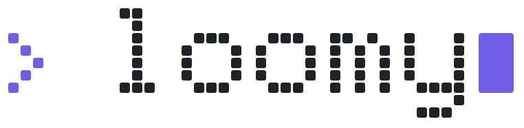
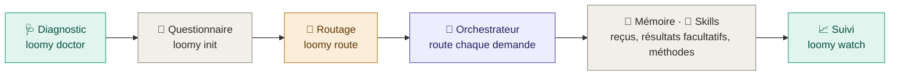
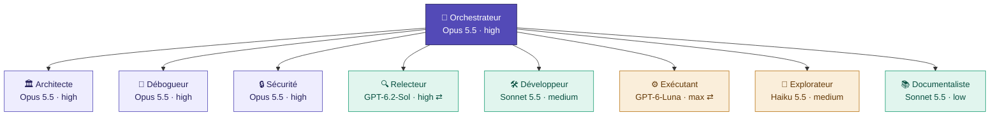

<div align="center">

<picture>
  <source media="(prefers-color-scheme: dark)" srcset="docs/assets/loomy-dark.svg">
  
</picture>

**Ton équipe de développement IA, orchestrée : Claude Code et Codex qui travaillent ensemble sur tes projets.**
Loomy cadre chaque projet, puis un orchestrateur sur le meilleur modèle confie chaque demande au rôle et au modèle qui la font de façon fiable au moindre coût, avec des relectures croisées entre les deux familles de modèles, des skills officiels, un état durable et des résultats privés facultatifs partagés entre les sessions et les outils, et tout le dispatch en direct dans ton terminal.


[🇬🇧 English](README.md) · 🇫🇷 Français

</div>

> [!NOTE]
> **Pré-version.** Loomy reste en 0.x tant que l'ensemble n'a pas été validé en conditions réelles. La version stable viendra après une phase de « release candidate » validée par les testeurs.

---

<p align="center"></p>
<p align="center"><sub>Arbre des agents (touche t) : chaque rôle avec l'outil, le modèle et l'effort réellement utilisés</sub></p>

<details>
<summary><b>Vue en direct (liste) : les agents en cours d'abord, puis le récapitulatif de session</b></summary>

<p align="center"></p>
<p align="center"><sub>Vue en direct : les agents en cours d'abord, regroupés par demande ou par modèle ([v]), le récapitulatif de session en dessous</sub></p>

</details>

## ✨ Pourquoi Loomy

| | |
|---|---|
| 🎯&nbsp;**Qualité** | Le meilleur raisonnement planifie, décide et relit ; chaque changement peut être relu par l'autre famille de modèles ; les caractéristiques du projet (comptes, paiements, données sensibles…) fixent les vérifications que les agents doivent faire. |
| 💰&nbsp;**Coût** | Chaque travail va au rôle le moins cher qui le fait de façon fiable (GPT-6-Luna pour les tâches cadrées, Sonnet 5.5 ou GPT-6.2 Sol pour le quotidien, Opus 5.5 pour l'architecture et la sécurité). Tokens, coût et quotas d'abonnement sont mesurés ; le travail passe à l'autre outil avant qu'un quota s'épuise. |
| 🧠&nbsp;**Continuité** | L’état du travail, la documentation durable et un commit par demande terminée gardent le fil entre sessions, compactages et outils. Les résultats privés facultatifs ajoutent une continuité locale ; les documents de continuité rédigés peuvent passer par la sauvegarde privée. |
| 🧩&nbsp;**Méthode** | Un type de projet et ses caractéristiques clés mettent en place la structure, les rôles et les skills officiels (Anthropic et OpenAI) dont les agents ont besoin, enrichis au fil du projet. |
| 👀&nbsp;**Visibilité** | L'orchestrateur à gauche, le dispatch à droite : phases, délégations, arbre des agents et coûts en direct, dans le terminal ou à côté de l'app de bureau. |

---

## ⚡ Démarrage rapide

**1. Installer Loomy** (une fois ; npm, bun ou script : voir « Installation »)

```bash
brew install eydenn/tap/loomy
```

**2. Vérifier la machine** (une fois)

```bash
loomy doctor --fix --live
```

**3. Créer le projet et répondre au questionnaire**, depuis n'importe quel dossier

```bash
loomy init
```

`loomy init` propose de créer un dossier au nom du projet (modifiable), d’utiliser le dossier courant ou un autre emplacement. `loomy init mon-projet` crée directement le dossier. La première utilisation interactive propose aussi deux choix distincts : les **libellés de tâche** et la conservation des **tâches/résultats privés**, avec **Oui** proposé pour chaque réponse ; rien ne s’active sans tes réponses. Voir les choix de confidentialité plus bas. À la fin, il propose d’ouvrir la session de l’orchestrateur.

**4. Rouvrir la session de l'orchestrateur** plus tard, depuis le dossier du projet

```bash
loomy start
```

**5. Suivre en direct** : `loomy start` ouvre déjà le suivi en direct à côté de la session ; `loomy watch` le rouvre n'importe où.

Le suivi continue après une erreur de collecte ou de réduction et affiche un avertissement en pied d’écran. `loomy doctor` signale les erreurs récentes sans contenu de conversation du journal privé borné `.loomy/logs/watch-errors.log`, les liens symboliques de sources qui désactivent le suivi et les journaux/checkpoints trop volumineux. `LOOMY_JOURNAL=0` désactive aussi l’écriture des erreurs. La découverte des sources de quota Codex est mise en cache pendant 15 secondes ; l’inventaire initial des sources est signalé pendant son rattrapage.

> [!TIP]
> Pour la suite, tape simplement **`loomy`** dans le dossier du projet : il affiche où en est le projet, ce qui est attendu de toi, et propose d'ouvrir ou reprendre la session, de suivre en direct ou de voir le statut.

---

## ✅ Prérequis

| | 🟢 Minimum | ⭐ Idéal |
|---|---|---|
| **Système** | macOS, bash ≥ 3.2 (celui de macOS convient), `git` ≥ 2.15 (2.44 ou plus recommandé) ; Linux : testé automatiquement (intégration continue), pas encore validé en usage réel | + `gh` connecté |
| **IA** | **une** CLI : Claude Code ≥ 2.1.280 **ou** Codex ≥ 0.155, connectée | **les deux**, installées dans le terminal et détectées par `loomy doctor` : mode hybride |
| **Modèles** | ceux de ton outil | tous répondent à `loomy doctor --live` |
| **Confort** | aucun (questionnaire intégré, sans dépendance) | presse-papiers, pour copier le prompt de démarrage |

**Installer Claude Code et Codex dans le terminal.** `loomy doctor` indique ce qui est détecté et affiche ces commandes pour une CLI absente ; `loomy doctor --fix` propose de les lancer pour toi.

**Claude Code** (installateur officiel)

```bash
curl -fsSL https://claude.ai/install.sh | bash
```

ou avec Homebrew

```bash
brew install --cask claude-code
```

**Codex** (installateur officiel)

```bash
curl -fsSL https://chatgpt.com/codex/install.sh | sh
```

ou avec Homebrew

```bash
brew install --cask codex
```

Lance ensuite `claude`, puis `codex`, une fois chacun pour te connecter (forfait Claude Pro, Max, Team ou compte Console ; compte ChatGPT pour Codex), et vérifie avec `loomy doctor --live`.

> [!IMPORTANT]
> - **Codex livré avec les apps ChatGPT et Codex.** `loomy doctor --fix` le rend accessible sous le nom `codex` grâce à un petit script dans `~/.local/bin`. Un lien symbolique ne marcherait pas : la CLI cherche ses programmes auxiliaires à côté du chemin par lequel on l'appelle.
> - **Claude Code trop ancien.** Les versions antérieures refusent `claude-opus-5-5`. Le diagnostic propose `claude update`.
> - **Session en bac à sable.** Si l'orchestrateur Claude Code tourne dans un bac à sable, autorise `loomy-delegate-codex.sh` à s'exécuter hors de ce bac à sable quand il le demande.

---

## 📦 Installation

Toutes les méthodes installent la même commande `loomy` ; aucune n'a besoin d'un compte GitHub.

🍺 **Homebrew** (recommandé sur macOS)

```bash
brew install eydenn/tap/loomy
```

📦 **npm**

```bash
npm install -g github:Eydenn/loomy
```

🥟 **bun**

```bash
bun add -g github:Eydenn/loomy
```

🐚 **Script shell**

```bash
git clone https://github.com/Eydenn/loomy.git ~/Tools/loomy && ~/Tools/loomy/install.sh
```

**Mise à jour**, quelle que soit la méthode :

```bash
loomy update
```

Plusieurs installations sur la même machine (par exemple Homebrew et npm) ? Pour voir celle qui est utilisée et comment retirer les autres :

```bash
loomy version --all
```

> [!TIP]
> `loomy update` détecte la méthode d'installation et utilise la bonne commande : `brew upgrade`, ou la dernière release pour npm et bun. Pour npm, la mise à jour se fait dans le même dossier que l'installation d'origine, même si tu as changé de version de Node (nvm) entre-temps. Avec Homebrew, `brew tap eydenn/tap` une fois permet ensuite de taper `brew install loomy` et `brew upgrade loomy`.

---

## 🧭 Comment ça marche



1. **Diagnostic.** Vérifie les versions des CLI, trouve Codex même caché dans l'app ChatGPT, contrôle les modèles disponibles, et propose les corrections.
2. **Questionnaire.** Dix questions en français, groupées par thème, chacune avec la conséquence de chaque choix. Un seul **type de projet** (application web / SaaS, site vitrine, API, **données et analyse**, application IA, mobile, desktop, CLI, modèles d'e-mails, ou **sur mesure**) pré-remplit la suite. Puis les **caractéristiques clés**, plusieurs à la fois et pré-cochées selon le type : comptes utilisateur, paiements, données personnelles, gros volumes de données, flux externes, API publique, IA dans le produit, temps réel, infra de production, multi-tenant ; elles fixent le risque et les vérifications confiées aux agents. Les précisions découlent du type (pour les données : sources, volume, livrables), puis viennent le stade et l'**équipe IA** : une ligne recommandée selon les outils détectés, ou Personnaliser (mode, outil principal, profil, format de délégation). Un récapitulatif montre **ce que Loomy va configurer** et des **recommandations** (effort, profil, modèles), seulement indicatives. La première fois, une onzième question demande tes forfaits Claude et ChatGPT. ← revient à la question précédente ; dans un champ texte, Tab reprend la suggestion pour la modifier (nom du projet, nom du dépôt…).
3. **Routage et skills.** Transforme le brief et les outils installés en une matrice rôle → modèle → effort, avec repli automatique si une CLI manque, et installe les skills officiels dont le projet a besoin.
4. **Orchestrateur.** La session principale suit `START.md` :

   <kbd>Découverte</kbd> → <kbd>Entretien</kbd> → <kbd>Proposition</kbd> → <kbd>✋ Validation</kbd> → <kbd>Construction</kbd> → <kbd>Vérification</kbd> → <kbd>Documentation</kbd> → <kbd>Commit</kbd> → <kbd>Clôture</kbd>

   Elle délègue le travail aux rôles dédiés et n'avance jamais sans ta validation.
5. **Au quotidien.** Chaque demande, tes retours compris, passe par l'orchestrateur : le rôle le moins cher capable la fait, l'autre famille de modèles la relit, la documentation durable est mise à jour et le travail commité.
6. **Mémoire et suivi.** Les faits des délégations sont enregistrés dans le journal et les reçus mémoire. Si tu actives les résultats privés, les tâches/résultats complets restent dans un stockage local séparé et borné, et leurs résumés peuvent être redonnés à une nouvelle session Claude Code ou Codex. L’état du travail et les documents rédigés conservent les décisions du projet. Tu suis tout en direct.

---

## 🚀 Avancer dans ton projet

Une fois `loomy init` terminé, tout passe par **l'orchestrateur** : une session Claude Code ou Codex, sur le meilleur modèle, qui suit `START.md` puis les règles du projet. Tu lui parles en français, il délègue aux rôles dédiés.

### 1. Ouvrir ou reprendre sa session

Le plus simple : **`loomy`** dans le dossier du projet, puis « Ouvrir ou reprendre la session de l'orchestrateur ».

| Où | Comment |
|---|---|
| 🖥️&nbsp;**Terminal,&nbsp;avec&nbsp;Loomy** | `loomy start` : un menu propose de **reprendre** la dernière session de ce dossier (avec son historique) ou d'en ouvrir une **nouvelle** avec le prompt adapté à la phase du projet. `--resume` et `--new` y vont directement. |
| ⌨️&nbsp;**Terminal,&nbsp;à&nbsp;la&nbsp;main** | Claude Code : `claude --continue` pour reprendre ; Codex : `codex resume --last`. Pour une nouvelle session, `loomy start --print` affiche la commande exacte (modèle et effort) et copie le prompt. |
| 🪟&nbsp;**Apps&nbsp;de&nbsp;bureau** | `loomy start --app` et `o` dans le suivi rouvrent la dernière session du projet : fil Codex existant, ou `claude --desktop --resume` avec Claude Code ≥ 2.1.285. Une session Claude occupée dans un terminal est refusée : utilise `/desktop` dedans ou termine-la. Sans session compatible, une nouvelle conversation est ouverte avec le prompt pré-rempli, jamais envoyé. Le suivi peut ouvrir une fenêtre Terminal à côté. |

> [!NOTE]
> Les sessions restent sur la machine où elles ont été ouvertes. Sur une autre machine, `loomy start` ouvre une nouvelle session : l'orchestrateur relit `START.md`, le brief et la phase enregistrée, et reprend là où le projet en est.
>
> Dans une app, autorise l'orchestrateur à lancer les scripts `.loomy/scripts/` : c'est par eux qu'il délègue à l'autre outil et qu'il enregistre les phases.

**La reprise est automatique.**
- **Claude Code :** à chaque ouverture de session dans le projet (terminal, app, `claude` tapé à la main), un hook installé par `loomy init` lui transmet d'office le contexte : phase, ce que tu dois faire, dernières délégations. Il commence par te dire où en est le projet. À la fermeture, la session est notée ; en mode dépôt privé, les fichiers IA sont sauvegardés.
- **Codex :** même mécanisme, via `.codex/hooks.json`. Au premier lancement dans le projet, Codex te demande de faire confiance au dossier, puis d'approuver les hooks Loomy : accepte les deux, c'est ce qui active la reprise automatique. Tant que ce n'est pas fait, `AGENTS.md` et le prompt de `loomy start` lui demandent de lire le contexte lui-même (`.loomy/scripts/loomy-context.sh`).
- **Suivi :** `loomy watch` et `loomy` indiquent si la session de l'orchestrateur est ouverte, et depuis quand.

### 2. Suivre les phases, et savoir quand c'est à toi

`loomy watch`, dans un second terminal, affiche la phase en cours, **ce que fait l'agent** et **ce que tu dois faire**.

| Phase | L'orchestrateur… | À toi |
|---|---|---|
| 1&nbsp;·&nbsp;Brief | attend d'être lancé | `loomy start` |
| 2&nbsp;·&nbsp;Découverte | lit le brief et explore le dossier | rien, garde sa session ouverte |
| 3&nbsp;·&nbsp;Entretien | pose les questions qui manquent | réponds dans sa session |
| 4&nbsp;·&nbsp;Proposition | présente stack, structure et plan | lis, questionne |
| 5&nbsp;·&nbsp;Validation | attend ton feu vert | **valide** ou demande des changements |
| 6&nbsp;·&nbsp;Construction | met en place le projet et délègue | suis les délégations |
| 7&nbsp;·&nbsp;Vérification | tests, relecture croisée, sécurité | regarde les constats remontés |
| 8&nbsp;·&nbsp;Documentation | écrit PROJECT.md, ARCHITECTURE.md, `.loomy/docs/` | relis |
| 9&nbsp;·&nbsp;Commit | commit initial, si autorisé | vérifie le commit |
| 10&nbsp;·&nbsp;Clôture | archive ou supprime START.md | rien |

### 3. Ensuite : le développement au quotidien

Le bootstrap terminé, `START.md` disparaît et l'orchestrateur suit `AGENTS.md` et `CLAUDE.md`.

- **`loomy task "…"`** : une tâche nommée (une fonctionnalité, un bug, un refactor).
  - Ses phases sont plan → validation → construction → vérification → commit, suivies dans `loomy watch` avec la durée, les délégations et le coût.
  - L'orchestrateur tient le plan et une liste d'avancement dans `.loomy/tasks/<n>-<nom>.md` : une longue tâche se reprend avec `loomy task --resume`.
  - `.loomy/TASKS.md` liste toutes les tâches, et `loomy task` seul affiche la liste.
- **`loomy review`** : une relecture croisée à la demande de la branche en cours, ou des modifications non commitées. En mode hybride, elle est faite par l'autre famille de modèles, en lecture seule, et enregistrée dans `.loomy/reviews/`.
- **`loomy report`** : les chiffres du projet (démarrage, tâches, délégations par rôle et par modèle, tokens, coût).
  - `--md` l'écrit en Markdown dans `docs/reports/`, à garder dans le dépôt.
  - `--all` compare tous les projets Loomy de la machine.
- **`loomy models`** : chaînes de modèles actuels validés et nouveaux candidats à évaluer. Propose les candidats sur GitHub (`--issue`, un ticket par modèle). `--thrifty` est retiré ; le profil Économe continue de baisser l’effort. Un candidat doit être validé dans le catalogue avant routage.

`loomy start` ouvre toujours une session libre.

> [!TIP]
> **Recommandations.** Une demande claire par session, avec le résultat attendu. Demande une proposition avant tout changement large. Relis chaque diff avant de committer. Pour les sujets sensibles (authentification, paiements, données personnelles), demande explicitement une revue du rôle sécurité.

### Tenu à jour tout seul

- **Au lancement.** `loomy`, `loomy start`, `loomy init`, `loomy task`, `loomy audit` et `loomy review` vérifient ce qui suit, sans rien ralentir (les versions en ligne sont mises en cache une fois par jour) :
  - existe-t-il un Loomy plus récent ?
  - Claude Code ou Codex est-il trop ancien pour les modèles routés, ou ne démarre-t-il plus ?
- **Une seule question.** S'il faut agir, une seule question, puis tout est fait d'un coup et la commande continue. Loomy se relance après sa propre mise à jour.
- **Le catalogue de modèles** se met à jour sans rien demander.
- **Les anciens projets** reçoivent automatiquement les relais des nouvelles commandes.
- **Pour désactiver :** `loomy config set auto_update no`.

**Une réparation qui insiste.** `loomy doctor --fix` (et la question au lancement) amènent Claude Code et Codex à une version qui fonctionne, quelle que soit la méthode d'installation (installateur officiel, npm, Homebrew, app de bureau). Les étapes sont essayées dans l'ordre, chacune vérifiée avant de passer à la suivante :
1. mise à jour sur place, avec la méthode de l'installation ;
2. réinstallation avec cette méthode ;
3. suppression d'une ancienne copie qui en cache une récente dans le PATH (le classique « la mise à jour n'a rien changé ») ;
4. réinstallation propre : toutes les copies supprimables, puis l'installateur officiel.

Les réglages, connexions et conversations (`~/.claude`, `~/.codex`) ne sont jamais touchés. Chaque étape est journalisée dans `~/.config/loomy/logs/repair-<outil>.log`. `loomy doctor` liste toutes les copies trouvées dans le PATH, avec leur méthode et leur version.

**Enregistrement des hooks et retour en arrière.** Loomy enregistre ses hooks dans `.claude/settings.json` et `.codex/hooks.json`, et la réparation automatique comme `loomy hooks repair` n'agissent que pour les fournisseurs que le projet utilise (`loomy init` et `loomy init --update` écrivent les deux). Tes propres hooks, ta ligne d'état et tes permissions sont conservés.
- `loomy hooks status` indique, pour chaque fournisseur et chaque événement, s'il y a quelque chose à faire (lecture seule) ;
- `loomy hooks repair` complète les enregistrements manquants ; `loomy hooks repair --shell` rétablit les enregistrements shell reconnus.

Avant de revenir à un Loomy plus ancien, tant que cette version est encore installée :
1. `loomy hooks status` ;
2. `loomy hooks repair --shell` ;
3. `loomy hooks status` à nouveau : il ne doit rester que des enregistrements shell et personnalisés (un fournisseur que le projet n'utilise pas peut encore afficher `manquant`). Corrige à la main les événements en conflit qu'il liste, puis recommence.

Installe seulement ensuite l'ancienne version. Répéter la mise à jour et la réparation ne duplique jamais un enregistrement. L'enregistrement natif des hooks n'est pas disponible dans cette version.

### 4. Mettre à jour, reprendre ou réinitialiser

| Besoin | Commande |
|---|---|
| Mettre&nbsp;à&nbsp;jour&nbsp;Loomy | `loomy update` : tous tes projets en profitent aussitôt (leurs scripts sont des relais vers le Loomy installé). `loomy init --update` ne sert plus qu'aux nouveaux modèles de documents, et une fois pour les projets d'avant la 0.3 (garde brief, phase et journal) |
| Projet&nbsp;déjà&nbsp;initialisé | `loomy init` propose : reprendre, mettre à jour, refaire le questionnaire, réinitialiser |
| Refaire&nbsp;le&nbsp;questionnaire | `loomy brief` |
| Recommencer&nbsp;le&nbsp;bootstrap | `loomy init --reset` : START.md recopié, phase remise à zéro, questionnaire relancé avec tes anciennes réponses |

---

## 🔒 Confidentialité : fichiers IA et stockage de l’activité

### Où vivent les fichiers IA

Les fichiers qui guident les agents (`AGENTS.md`, `CLAUDE.md`, `.claude/`, `.codex/`, `.loomy/`, `START.md`) sont tes règles de travail. GitHub règle la visibilité **par dépôt**, pas par fichier : un dépôt public montre tout ce qu'il contient. Le questionnaire te demande où les garder, avec une valeur par défaut qui dépend de ton dépôt. Quel que soit le mode, l'historique et les fichiers de travail de Loomy (journaux, mémoire, tâches, audits, revues…) n'entrent jamais dans le dépôt du projet.

Le questionnaire propose aussi de **créer le dépôt GitHub** du projet, privé ou public. Son nom, tiré du nom du projet, est à valider ou à modifier. En mode dépôt privé séparé, le nom du dépôt des fichiers IA (`<dépôt>-ai`) l'est aussi, et les deux sont confirmés ensemble. Un dépôt existant qui porte un autre nom est signalé, avec la commande pour le renommer ; Loomy ne renomme rien lui-même.

| Mode | Pour qui | Ce qui se passe |
|---|---|---|
| **Versionnés** | dépôt privé *(défaut)* | les règles et la doc des agents sont dans le dépôt : tu les retrouves partout, les agents en ligne les lisent (historique et fichiers de travail restent locaux) |
| **Locaux** | dépôt public, sans sauvegarde | exclus via `.git/info/exclude` (invisible dans le dépôt) ; perdus si tu changes de machine |
| **Dépôt privé séparé** | dépôt public *(recommandé)* | exclus du projet et sauvegardés dans un dépôt GitHub privé `<projet>-ai`, qui ne suit que ces fichiers |

Voir le mode et l'état de la sauvegarde :

```bash
loomy privacy
```

Changer de mode (un seul des trois) :

```bash
loomy privacy versioned
```

```bash
loomy privacy local
```

```bash
loomy privacy private
```

Sauvegarder les fichiers IA dans le dépôt privé (l'orchestrateur le fait aussi en fin d'étape) :

```bash
loomy privacy sync
```

Sur une autre machine, après avoir cloné le projet, récupérer ses fichiers IA :

```bash
loomy privacy restore <ton-compte>/<projet>-ai
```

> [!NOTE]
> Loomy ne pilote qu'un `.loomy/ai.git` qu'il a créé lui-même (enregistré dans `~/.config/loomy/companions`, hors du projet) : un clone peut livrer un faux avec ses propres hooks. Un dépôt créé par une ancienne version de Loomy, ou copié d'ailleurs, affiche `Historique privé non vérifié · lance loomy privacy adopt` dans `loomy status` et `loomy doctor` et n'est pas sauvegardé automatiquement ; `loomy privacy adopt` vérifie ses réglages (ni hooks, ni filtres, ni commandes), affiche ses URL distantes, te demande de confirmer dans un terminal et lui fait confiance. Un dépôt qui change ensuite (réglages, URL distante, opération en cours, suivi par le projet) est refusé de nouveau jusqu'à un nouveau `adopt` ; un dépôt distant local n'est accepté par `adopt` que comme chemin absolu d'un dossier existant qui t'appartient, hors du projet (les chemins relatifs, `./` et dans le projet sont refusés), et seulement après confirmation de l'URL.

> [!WARNING]
> Un fichier déjà envoyé sur un dépôt public reste dans son historique. Quand tu passes en mode local ou privé, `loomy privacy` liste les fichiers encore suivis et donne la commande pour arrêter de les suivre sans les supprimer de ton disque. `--remote <URL>` permet d'utiliser un autre hébergeur que GitHub pour le dépôt privé.

### Journal et libellés de tâche

**Depuis la 0.17.8, les nouvelles entrées du journal et les instantanés de rotation sont structurels par défaut :** identifiants, rôles, modèles, effort, cycle de vie, durées, compteurs et coûts. Ils omettent les prompts, le corps des tâches, les résultats et les chemins des fichiers modifiés. Les journaux et archives existants restent intacts.

Les libellés de tâche utilisent un **stockage local séparé**, `.loomy/logs/display-context-v1.jsonl`, avec une autorisation par source : `explicit-user`, `explicit-lead`, `claude-description`, `codex-path-slug`, `codex-nickname`, `codex-role`. Claude utilise la **description** Agent/Task, jamais son prompt ; Codex utilise le dernier composant du chemin d’agent, le surnom et le rôle. Les libellés explicites viennent de ta commande `privacy label` ou de l’option `--task-label` d’un bridge.

Les libellés sont assainis et coupés entre graphèmes : au plus **96 graphèmes / 384 octets UTF-8**, **40 caractères ASCII par composant Codex**, et **1 Mio** pour le stockage des libellés. S’il est plein, Loomy indique que le libellé n’a pas été enregistré. Les vues locales arbre/liste, diagramme, statut, journal de session, journal lisible et récapitulatif résolvent un libellé autorisé, puis la mission d’un rôle connu (`Rôle : …`), sinon un contexte indisponible. L’ancien texte du journal reste lisible.

| Commande | Ce qu’elle change |
|---|---|
| `loomy privacy content [structural\|legacy-excerpts]` | Afficher la politique, ou choisir les écritures structurelles / les extraits de compatibilité bornés |
| `loomy privacy labels [recommended\|off]` | Afficher les choix de libellés ; activer les six sources recommandées, ou les désactiver |
| `loomy privacy labels set explicit-lead,claude-description` | Remplacer les sources par l’ensemble choisi |
| `loomy privacy label --id <id> "Titre court"` | Libeller explicitement un agent identifié ; `--kind` et `--attempt` sélectionnent un autre type de cible ou une tentative |
| `loomy privacy results [on\|off]` | Afficher ou changer la capture future des tâches/résultats complets ; les résultats existants restent en place |

`legacy-excerpts` n’autorise que les champs de compatibilité bornés `task`, `excerpt`, `why`, `nickname` et `cwd_relative` ; il n’active ni les sources de libellés ni les résultats privés. Ajouter des sources, activer les résultats privés ou élargir la conservation exige **ta confirmation directe dans un terminal ordinaire**, pour ce projet et les limites affichées. Les agents, hooks, bridges, terminaux gérés et réponses par pipe ne peuvent pas donner cet accord par les commandes Loomy prévues. Un agent sous ton utilisateur système peut toujours modifier les fichiers locaux ou changer son environnement de lancement ; cette protection n’est pas une isolation système. Restreindre ou désactiver reste possible sans interaction. Les worktrees partageant le stockage d’activité enregistré du projet partagent ces choix ; un autre clone ne les reçoit pas par synchronisation.

`LOOMY_JOURNAL=0` désactive les écritures du journal et la collecte native, pas tous les documents de Loomy. `LOOMY_JOURNAL_TASKS=0` interdit les nouvelles captures automatiques de tâches/extraits/libellés et de tâches/résultats complets, même avec une autorisation existante. `loomy config set memory off` arrête l’injection de contexte ; utilise `loomy privacy results off` pour arrêter la capture future des résultats.

### Choix à la première utilisation

Le premier `loomy init` ou `loomy watch` interactif pose une seule fois par projet :

- **Conserver les libellés de tâche ? [O/n]** — **Oui** par défaut, avec les six sources et les limites des libellés affichées.
- **Conserver aussi les tâches/résultats privés ? [O/n]** — un **Oui** distinct par défaut, avec les limites des résultats privés affichées.

Entrée sur chaque question affichée accepte sa valeur par défaut. Les choix ne sont enregistrés qu’une fois les deux réponses complètes. Un refus est mémorisé ; désactiver un choix ensuite ne le réactive jamais silencieusement. Un écran interrompu ou une utilisation non interactive n’accorde rien et laisse la question en attente ; les autorisations valides existantes restent utilisables. Avant tes réponses, le défaut est un journal structurel avec libellés et résultats privés désactivés, et le statut affiche `Libellés de tâche désactivés · lancer loomy privacy labels recommended`.

Après une mise à jour depuis la **0.17.6**, ouvre `loomy init` ou `loomy watch` dans ton terminal pour faire ces choix : `loomy update` seul ne les autorise pas.

### Inventorier les copies stockées

```bash
loomy privacy inventory
```

Cet inventaire en lecture seule donne les catégories de stockage connues, le nombre et la taille des fichiers depuis leurs métadonnées, sans lire leur contenu, copier, modifier ni supprimer de fichier. `--root DIR` choisit un projet, `--json` renvoie les métadonnées en JSON, `--paths` inclut les chemins locaux échappés, `--git-history` vérifie les métadonnées de l’index et de l’historique Git local, et `--host` ajoute les emplacements hôte et temporaires connus. Il ne contacte aucun dépôt distant et ne parcourt pas les conversations des fournisseurs ; une couverture incomplète est signalée, sans conclure que tout est sûr.

Les nouveaux libellés, reçus mémoire et résultats privés sont exclus du dépôt du projet, du dépôt IA privé, de la synchronisation, de la restauration et du contexte automatique des retours. Les documents rédigés `STATE.md`, `DEAD-ENDS.md` et `HANDOFF.md` gardent leur rôle explicite de continuité dans la sauvegarde privée. Les retours construisent leur contexte automatique depuis les informations d’environnement/configuration autorisées et les 15 derniers événements projetés structurellement, sans copier le brief ni le journal brut ; ton message rédigé fait toujours partie de l’issue prévisualisée.

**Expositions restantes en 0.17.8 :** checkpoints natifs/sauvegardes/fragments et curseurs d’usage, fichiers temporaires d’exécution/diagnostic/affichage, `loomy log --raw`, exports explicites `loomy report --md` et arguments de tâche des fournisseurs peuvent encore contenir du texte ou des chemins identifiants. Les conversations des fournisseurs et les documents de tâche/revue/audit explicitement demandés gardent leur propre conservation. Changer la politique ou lancer l’inventaire ne purge ni anciens fichiers, ni historique Git, ni clones distants, ni sauvegardes système.

---

## 📈 Suivi en direct

Tout se passe dans le terminal, sans dépendance. `loomy start` ouvre le suivi en direct à côté de la session ; `loomy watch` l'ouvre n'importe où, à tout moment.

| Commande | Ce qu'elle fait | Options principales |
|---|---|---|
| `loomy status` | Instantané : phases, délégations, coûts, quotas, Git | — |
| `loomy watch` | Agents en direct (v demande/modèle, o orchestrateur, l journal, t agents/diagramme, q quitter) | `N` |
| `loomy tree` | Arbre des agents : orchestrateur, conseiller et rôles en direct | — |
| `loomy start` | Session et suivi en direct côte à côte | `--no-watch` |
| `loomy log` | Journal lisible des phases, délégations et sessions | `--raw` `--since AAAA-MM-JJ` `--csv` |

Chaque commande en détail : [docs/COMMANDS.fr.md](docs/COMMANDS.fr.md).

**Ce qui est en direct.** Les lancements sont détectés toutes les 250 ms ; les chronos en cours avancent chaque seconde :
- les **délégations**, via les bridges et les agents natifs Claude ou Codex, s'affichent pendant leur exécution sous **EN COURS**, avec le modèle enregistré (actualisé depuis l'usage réel quand il est disponible), l'effort, la durée et le libellé autorisé ou le contexte du rôle ; **SESSION** récapitule uniquement les rôles terminés de la session courante de l'orchestrateur, avec ✓ terminé, △ partiel, ■ bloqué et ✗ échec et ⊘ interruption. L'usage des sous-agents Claude natifs n'est compté qu'une fois ; l'usage et le coût des agents Codex natifs restent inconnus sans mesure distincte. Chaque session de l'orchestrateur forme un seul groupe, intitulé par sa surface, son identifiant et `en direct` ou `inactive` ; une session inactive sans rien en cours n'apparaît que dans le récapitulatif (sous la ligne de défilement, l'intitulé du groupe est répété avec la mention `récapitulatif`), et une délégation dont le lanceur a disparu se termine en ⊘ interrompu, jamais en cours ;
- le **regroupement** par demande ou modèle se change avec `v` et se mémorise dans `watch_group` (`request` par défaut ; `loomy config set watch_group model` le change). Les nouveaux événements structurels de demande utilisent des identifiants plutôt que des extraits de prompt ; les anciens journaux et le mode de compatibilité explicitement activé peuvent encore contenir des extraits. ⚑ signale une demande explicite et ⇢ un écart au routage ;
- **l'orchestrateur** s'ouvre avec `o` dans une app de bureau disponible, sinon dans une fenêtre de terminal séparée avec session et suivi côte à côte ;
- la **phase** change quand l'orchestrateur l'enregistre (`START.md` le lui demande à chaque étape) ; c'est la dernière information enregistrée, pas un avancement déduit automatiquement ;
- le travail que l'orchestrateur fait lui-même se suit dans sa session ; les événements de message et d'usage alimentent la vue sans exposer sa conversation complète.

Le journal (`.loomy/logs/events.jsonl`) reste sur ta machine : il est exclu de Git automatiquement. Les nouvelles entrées sont structurelles par défaut ; les libellés autorisés et résultats privés sont stockés séparément selon les choix de confidentialité plus haut. Les anciennes entrées ne sont pas réécrites.

Un tour d'agent natif terminé est un événement de cycle de vie, pas une validation de son travail. L'orchestrateur vérifie toujours les résultats partiels ou bloqués et les relectures indépendantes avant d'accepter une tâche ou de publier une version. Les tours suivants doivent rester visibles ; le temps écoulé n'est pas un pourcentage d'avancement.

Le suivi natif Codex lit les métadonnées et événements de cycle de vie des fichiers de session locaux. Il n'appelle aucun modèle et ne recopie ni conversation ni arguments d'outils dans le journal. Des événements absents ou non reconnus ne valent pas réussite. La collecte découvre les fichiers récents à une cadence bornée, puis lit seulement leur suite ; ses limites de compatibilité et d'observation sont documentées dans l'[ADR-0007](docs/adr/0007-native-codex-observability.md).

**Un seul collecteur en direct par projet (0.17.10).** Un seul processus par projet, partagé par tous ses worktrees, collecte l’activité native Codex et Claude à la fois : le premier `loomy watch` (ou un `loomy status`/`loomy tree` ponctuel, le temps de la commande). Toutes les autres vues le suivent : elles lisent les données enregistrées, n’écrivent rien et affichent `Suit un autre watch · q ferme cette vue` ; `q` ne ferme que cette vue, et un suiveur prend le relais quand le propriétaire quitte. Un propriétaire qui quitte termine son lot en cours en quelques secondes puis se libère ; le pied d’écran l’indique. `loomy doctor` montre le propriétaire (build, pid, démarrage, époque) ou son absence. Les anciennes versions de Loomy ne connaissent pas cette règle : **avant de mettre à jour ou de revenir en arrière, ferme chaque `loomy watch` ouvert avec `q`**, change de version, puis rouvre-le ; ne lance pas un ancien et un nouveau watch sur le même projet, car rien n’empêche un ancien build de collecter lui aussi. Si un watch n’arrive pas à finir d’enregistrer, garde la nouvelle version et lance `loomy doctor`.

### 💳 Forfaits Claude et ChatGPT

Loomy sait si tu paies à l'usage (API) ou par abonnement, outil par outil :

| Forfait | Ce que Loomy affiche |
|---|---|
| API | le **coût** réel (Claude) ou estimé à partir des tokens (Codex), par tâche et par mois |
| Claude&nbsp;Pro&nbsp;·&nbsp;Max&nbsp;5x&nbsp;·&nbsp;Max&nbsp;20x&nbsp;·&nbsp;Team | la **part de ton quota utilisée** : fenêtres de 5 heures et de la semaine, avec leur heure de remise à zéro ; des **tokens** par tâche plutôt que des dollars |
| ChatGPT&nbsp;Plus&nbsp;·&nbsp;Pro&nbsp;·&nbsp;Business | idem, d'après les fenêtres que rapporte Codex |

```text
◇  FORFAITS  quota pour les abonnements, coût pour l'API
│  Claude          Claude Pro · 5 h 42 % (remise à zéro 12:57) · semaine 86 % (remise à zéro jeu. 23:17)
│  Codex           ChatGPT Business · semaine 12 % (remise à zéro mer. 19:30)
```

`loomy watch` te prévient quand un quota dépasse 80 %, puis 95 %.

**Disponibilité des fournisseurs pour les délégations.** Un refus réel (quota, crédits ou débit), ou un quota à 100 % / limite atteinte, passe le rôle à l’autre fournisseur installé qui a de la marge. À 95–99 %, une délégation tente encore le travail :
- le rôle utilise le modèle actuel validé et l’effort routé de l’autre fournisseur ;
- un rôle d’écriture passé à Claude obtient les modifications et commandes shell dans le sandbox de Claude Code (dossier du projet, sans réseau) ; les rôles de lecture restent en lecture seule ;
- le passage est annoncé et journalisé comme `handed_over`, séparément des échecs ;
- il y a un seul passage par appel, sans réessai sur un modèle voisin du fournisseur saturé ;
- si aucun fournisseur ne peut répondre, le bridge sort avec le code 75, `paused` / `waiting_for_reset` et `resume_at` ; après cette date, l’orchestrateur vérifie les modifications partielles et ne reprend qu’avec la tâche exacte et les options structurées du contexte vivant ou d’une référence de tâche/résultat privé autorisée. À défaut, il signale **tâche d’origine nécessaire pour reprendre** et arrête le travail dépendant. Voir Mémoire partagée plus bas.
- si un fournisseur n’a plus de crédits (limite non datée), le bridge confie le rôle une fois à l’autre, ou sort avec le code 69, `outcome: "credits"` et sans `resume_at` : l’orchestrateur n’attend pas, ne relance pas, et dit à l’utilisateur d’ajouter des crédits ou de changer de fournisseur/modèle.

Le seuil de relais préventif du lead reste distinct : `loomy config set quota_switch 90` (un pourcentage), ou `off` pour désactiver les relais préventifs. Un refus réel du fournisseur continue de protéger les délégations.

**Relais de l'agent principal quand un forfait s'épuise.** L'agent principal défini dans le brief ne change jamais ; l'autre outil le remplace seulement pour un temps :
- à 90 % (seuil de bascule moins 5), un agent principal Claude Code est prévenu à chaque message (au plus toutes les 10 minutes) de terminer l'étape, d'écrire `.loomy/docs/HANDOFF.md` et `STATE.md`, de committer et de terminer la session ; Codex n'a pas de hook par message, donc un agent principal Codex n'est prévenu que par `loomy watch` et au démarrage de la session ;
- à 95 %, si l'autre outil est installé, dispose d'un abonnement et reste sous 80 %, la chaîne terminale de `loomy start` l'ouvre comme agent principal avec un prompt de relais (5 secondes pour annuler avec Ctrl+C, 6 sessions au plus par chaîne) ; `loomy start --app` enregistre et ouvre une session sans chaîne, et un prochain `loomy start` rend la main à l'agent principal dès que son quota le permet ; le routage suit l'agent principal en place pendant ce temps ;
- dès que l'agent principal repasse sous 80 %, ou que sa fenêtre est remise à zéro, l'agent en place en est prévenu de la même façon et l'agent principal reprend la main avec un prompt de retour ;
- un agent principal sur un forfait API ne relaie jamais, et un outil API ne peut pas recevoir le lead ; `loomy config set lead_failover off` ou `LOOMY_NO_SWITCH=1` désactive les relais ; `quota_room` (80 par défaut) fixe la part sous laquelle un outil a de la marge.

`loomy start --lead codex|claude` choisit un agent principal temporaire manuel (affiché `(manual)`, conservé même si l’agent principal du brief a de la marge, avec le relais automatique de quota qui protège toujours l’agent en place), à la place de `AI_ROUTE_ENV` pour cet usage ; `loomy start --lead auto` ou `--lead <master>` rend la main à l’agent principal du brief.

`loomy start --lead codex --only` (ou `--lead claude --only`) route tous les rôles vers cet outil pour la session terminal. Aucun brief ni dossier de projet n’est copié ou modifié. Le suivi et `loomy route` affichent « lead codex · uniquement ». Seuls les descendants de cette session terminal héritent du choix ; les marqueurs utilisent le PID et la date de démarrage du propriétaire. La fin de session efface son marqueur ; un autre terminal ou `--lead auto` ne supprime jamais celui d’une session vivante. `--print` reste sans écriture. `--only` exige un lead explicite et une session terminal (`--new` ou `--resume`) ; les apps n’exposent pas de processus propre à la session pour borner ce choix.

Le relais est gardé dans `.loomy/failover`, affiché par `loomy status` et `loomy watch` (⇄), et journalisé (`lead_failover`, `lead_return`).

D'où viennent les chiffres, sans réseau ni identifiants :
- **Codex** écrit son quota dans ses propres journaux de session (`~/.codex/sessions`) ; Loomy lit le dernier relevé.
- **Claude Code** transmet à sa commande de barre d'état un champ documenté `rate_limits`. `loomy init` ajoute au projet une petite barre d'état Loomy (`.claude/settings.json`) qui l'enregistre, puis affiche **ta propre barre d'état** si tu en as une (une barre d'état déjà définie dans le projet n'est jamais remplacée). Le quota Claude apparaît dès qu'une session a répondu dans un projet Loomy.

Forfait Claude : `api`, `pro`, `max5`, `max20`, `team` ou `enterprise`

```bash
loomy config set plan_claude max20
```

Forfait ChatGPT / Codex : `api`, `plus`, `pro100`, `pro200`, `business` ou `enterprise`

```bash
loomy config set plan_codex pro200
```

Prix personnalisé du forfait (en $ par mois), utilisé par `loomy stats` pour le comparer à la valeur API de ton travail

```bash
loomy config set plan_claude_price 180
```

### 📊 Statistiques détaillées

```bash
loomy stats
```

Délégations et taux de réussite, durées totale et moyenne, tokens (entrée, cache, sortie) et travail propre de Claude Code (orchestrateur, sous-agents), puis par rôle, par modèle (avec la part du cache) et par jour, et tes forfaits. Avec un abonnement, les montants s'affichent en `≈$…` : ce que le travail coûterait via l'API, couvert par le forfait, à côté de son prix mensuel. `--days 7` ou `--since AAAA-MM-JJ` pour une période ; `loomy log --csv` pour les chiffres bruts.

---

## 🎯 L'orchestrateur et ses rôles

La session principale, l'**orchestrateur**, garde le meilleur raisonnement pour planifier, déléguer, décider et vérifier. Le reste du travail est confié à des rôles dédiés.



<sub>Mode hybride avec Claude Code en lead, profil Équilibré. ⇄ = rôle exécuté par l'autre outil, via un bridge. 🟪 pointe · 🟩 standard · 🟧 rapide.</sub>

### 🗺️ Matrice complète (profil Équilibré)

| Rôle | 🟠 Full Claude | 🔵 Full Codex | 🟣 Hybride, lead Claude | 🟣 Hybride, lead Codex |
|---|---|---|---|---|
| 🎯&nbsp;**Orchestrateur** | Opus 5.5 · high | Sol 6.2 · high | **Opus 5.5 · high** | Sol 6.2 · high |
| 🏛️&nbsp;Architecte | Opus 5.5 · high | Sol 6.2 · high | Opus 5.5 · high | Opus 5.5 · high ⇄ |
| 🐞&nbsp;Débogueur | Opus 5.5 · high | Sol 6.2 · xhigh | Opus 5.5 · high | Opus 5.5 · high ⇄ |
| 🔒&nbsp;Sécurité | Opus 5.5 · high | Sol 6.2 · high | Opus 5.5 · high | Opus 5.5 · high ⇄ |
| 🔍&nbsp;Relecteur | Sonnet 5.5 · high | Sol 6.2 · high | Sol 6.2 · high ⇄ | Sonnet 5.5 · high ⇄ |
| 🛠️&nbsp;Développeur | Sonnet 5.5 · medium | Sol 6.2 · high | Sonnet 5.5 · medium | Sol 6.2 · high |
| ⚙️&nbsp;Exécutant | **Haiku 5.5 · high** | **Luna · max** | **Luna · max** ⇄ | **Luna · max** |
| 🔎&nbsp;Explorateur | Haiku 5.5 · medium | Luna · low | Haiku 5.5 · medium | Luna · low |
| 📚&nbsp;Documentaliste | Sonnet 5.5 · low | Sol 6.2 · low | Sonnet 5.5 · low | Sol 6.2 · low |

**Profils de budget.** L'orchestrateur reste toujours sur le meilleur modèle ; seuls les efforts et les modèles des rôles changent.

| Profil | Effet |
|---|---|
| 💚&nbsp;Économe | orchestrateur Claude sur Sonnet 5.5 `medium` (Codex sur Sol 6.2 `medium`), spécialistes en `medium`, exécution sur les modèles rapides |
| 💛&nbsp;Équilibré&nbsp;*(défaut)* | la matrice ci-dessus |
| ❤️&nbsp;Qualité&nbsp;max | orchestrateur et spécialistes en `xhigh`, revues sur le modèle de pointe, exécution sur Sol ou Sonnet `high` |

> [!NOTE]
> **Replis automatiques.** Si le mode demande les deux outils mais qu'une CLI manque, le routage bascule sur la matrice complète de l'outil disponible. Si l'outil principal manque, c'est l'autre qui orchestre.
>
> **En hybride :**
> - la revue vient toujours de l'autre famille de modèles ;
> - l'architecture, la sécurité et le debug passent toujours par Opus 5.5 ;
> - l'exécution passe toujours par GPT-6-Luna.
>
> Choisis **Claude Code comme outil principal** pour avoir Opus 5.5 en orchestrateur. C'est le choix par défaut du questionnaire.

---

### 🧭 Le conseiller

Claude Code peut donner à la session un **conseiller** plus fort ([documentation Claude Code](https://code.claude.com/docs/en/advisor)). Le conseiller lit toute la session et est consulté aux moments clés : avant un plan, quand une erreur se répète, avant de déclarer une tâche terminée. Loomy lance l'orchestrateur Claude avec lui selon le profil :

| Profil | Orchestrateur | Conseiller |
|---|---|---|
| Économe | Sonnet 5.5 medium | **Opus 5.5** : du jugement aux moments clés sans payer Opus à chaque tour |
| Équilibré | Opus 5.5 high | aucun (en option) |
| Qualité max | Opus 5.5 | **un second Opus**, pour une vérification indépendante |

- **Réglage :** `loomy config set advisor auto|off|opus|sonnet|fable`. Fable demande un accès Fable et se facture en crédits d'usage sur certains forfaits.
- **Associations :** seules celles que Claude Code accepte sont utilisées ; un orchestrateur Codex n'a jamais de conseiller.
- **Mesuré :** chaque consultation est journalisée avec son modèle, ses tokens et son coût, et apparaît dans `status`, `report` et l'arbre des agents. Une consultation lit toute la session, environ 35 000 tokens dans notre test.
- **Vérifications :** `loomy doctor` prévient quand une variable (`DISABLE_TELEMETRY`…) empêche le conseiller de fonctionner.
- **Nécessite Claude Code 2.1.286 ou plus récent** ; Loomy le met à jour au lancement.

### 🧾 Délégations structurées

Les agents s'échangent normalement tâches et résultats en prose. Avec les **délégations structurées** (un choix du questionnaire, recommandé), ils utilisent des champs fixes : moins de tokens, rien de perdu dans la formulation, et des résultats que l'orchestrateur et les bridges peuvent vérifier.

```text
GOAL / SCOPE / FILES / ACCEPTANCE                          ← la tâche de l'orchestrateur
STATUS: done | partial | blocked                           ← la réponse de chaque rôle
SUMMARY · FINDINGS (chemin:ligne, preuve) · FILES · CHECKS · RISKS · NEXT
```

Donne à chaque bridge un titre d’affichage court et délibéré, séparé de sa tâche complète :

```bash
loomy delegate codex reviewer --task-label "Relire le correctif de connexion" "Relire les modifications de connexion en cours"
```

`loomy delegate claude` accepte la même option `--task-label`. Son enregistrement utilise l’autorisation `explicit-lead` existante ; le bridge ne peut ni accorder la permission ni déduire un titre du corps de la tâche. Les descriptions natives Claude et les noms d’agents Codex utilisent leurs propres autorisations de source.

Les bridges ajoutent ce contrat à leur prompt, les sous-agents Claude générés le portent, et l'orchestrateur a pour consigne d'agir selon `STATUS`. Le journal enregistre le résultat : `loomy status` et `loomy log` marquent ◐ les résultats partiels et ■ les résultats bloqués, `loomy stats` indique combien de réponses ont respecté le format. Les projets créés avant cette option restent en texte libre ; change un projet avec `loomy brief` (questionnaire refait) ou tous avec `loomy config set delegation_format structured` (`auto` : le choix de chaque projet).

Quand un rôle de revue ou de sécurité ne trouve aucun défaut, il ajoute une courte section `TRIED` (ce qu'il a attaqué) ; un `FINDINGS` vide sans `TRIED` compte comme une revue incomplète, signalée par `loomy stats`, `loomy log` et `loomy status`. Pour les projets de type « Données et analyse », une règle gérée dans `AGENTS.md` / `CLAUDE.md` impose des chiffres issus de code exécuté et versionné, une validation sur une période réservée découpée dans le temps pour les données temporelles, et un validateur distinct de l'auteur de la proposition.

C'est un protocole texte, qui fonctionne avec Claude et Codex tels quels. L'échange des états internes des modèles (« communication latente ») relève encore de la recherche : il faut accéder à l'intérieur des modèles, ce que les produits Claude et Codex ne permettent pas.


### 🧠 Mémoire partagée

L’état du travail rédigé garde le fil entre sessions, compactages et Claude Code/Codex. Les tâches/résultats privés ajoutent une continuité locale quand tu les autorises ; ils restent sur cette machine. Sur une autre machine, l’orchestrateur utilise les documents de continuité rédigés que tu as choisi de sauvegarder.

| Quoi | Où | Écrit par |
|---|---|---|
| Faits de délégation : identité, rôle, modèle/effort, état, dates, nombre de fichiers et références bornées ; aucun corps de tâche/résultat | `.loomy/memory/receipts-v1/` | bridges et hooks natifs Claude, automatiquement |
| Tâches/résultats complets et options de reprise structurées, uniquement avec ton accord | `.loomy/memory/private-results-v1/` (local seulement, fichiers créés en 0600) | capture automatique autorisée |
| État du travail : fait, en cours, décisions, suite | `.loomy/memory/STATE.md` (exclu du Git du projet ; sauvegardé en mode privé) | l’orchestrateur, après chaque étape importante |
| Anciens résultats sensibles de délégation | `.loomy/memory/delegations/` (gardés intacts) | anciennes versions de Loomy ; lecture séparée avec `loomy memory show legacy [N]` |

- **Stockage activé :** `loomy privacy results on` exige une confirmation humaine. Limites par défaut : **200 entrées, 1 Mio par entrée, 16 Mio au total et 30 jours** ; la conservation est évaluée à chaque enregistrement. Les entrées en cours sont protégées tant que leur processus est vivant, pendant 24 heures au plus ; les entrées en pause le sont jusqu’à 30 jours après `resume_at` (ou leur date d’enregistrement si la réinitialisation est inconnue). Un résultat trop volumineux ou un stockage plein d’entrées protégées est refusé visiblement : `résultat non enregistré / tâche d’origine nécessaire`. Loomy ne tronque jamais silencieusement un résultat pour le garder et ne purge pas l’ancien dossier de délégations.
- **Stockage désactivé :** `loomy privacy results off` arrête la capture future des tâches/résultats complets. Les reçus restent disponibles ; les nouveaux résumés ne sont pas conservés. Les entrées déjà autorisées restent lisibles. Les reçus seuls ne permettent pas de reconstituer la tâche ou le résultat d’origine.
- **Lecture :** `loomy memory` montre l’état du travail, les reçus et les résumés de résultats privés disponibles. `loomy memory show [N]` utilise le même classement et affiche le reçu et la tâche/le résultat complets autorisés quand ils sont disponibles ; sinon il indique que le résultat n’a pas été conservé. `loomy memory show legacy [N]` lit séparément les anciens résultats sensibles.
- **Redonnée au début d’une nouvelle session**, Claude Code comme Codex, et après un compactage : l’état du travail, puis les nouveaux faits des reçus et résumés privés disponibles qui n’y sont pas encore repris. Quand la session précédente s’est tenue dans l’autre outil, l’orchestrateur est prévenu de reprendre à partir de là. Une conversation reprise ne reçoit pas de nouveau le résumé mémoire.
- **Pensée pour le coût.** Rien n’est ajouté à chaque message. Le bloc est plafonné (40 lignes d’état, 4 résultats d’une ligne chacun) puis mis en cache par l’outil : quelques centaines de tokens par nouvelle session, au lieu de dizaines de milliers pour tout réexplorer. `STATE.md` est écrit en anglais et en style télégraphique, quelle que soit la langue de la documentation. Pour transmettre des constats à un rôle, l’orchestrateur lui indique le fichier autorisé au lieu de le recopier.
- **Registre des impasses.** `STATE.md` contient une section « Dead ends » partagée : une ligne par approche écartée, à ne jamais retenter sans nouvelle raison. Elle est redonnée au début d’une session dans Claude Code comme dans Codex et suit les passations. Les entrées plus anciennes sont archivées dans `.loomy/memory/DEAD-ENDS.md` ; les trois dernières restent toujours. Une simple lecture ne crée jamais `STATE.md`.
- **Les résultats sont des données :** l’orchestrateur les vérifie avant d’agir. `loomy config set memory off` désactive l’injection de contexte ; il ne désactive pas le stockage.

**Une tâche en pause utilise des données de reprise structurées**, et non une chaîne shell `Resume:` exécutable. Après `resume_at`, l’orchestrateur garde exactement le rôle, le fournisseur, le modèle, l’effort, la sandbox et les options, vérifie les modifications existantes et utilise la tâche d’origine du contexte vivant ou une référence de tâche/résultat privé autorisée. Sans elle, l’état est **tâche d’origine nécessaire pour reprendre** : le travail dépendant s’arrête. Une nouvelle pause utilise son nouveau `resume_at` ; ne jamais lancer deux fois pour une pause, deviner la tâche ni remplacer le modèle par un moins puissant.


### 🧩 Skills officiels

Les skills donnent aux agents une méthode éprouvée pour un type de travail (tests dans le navigateur, déploiement, modèle de menace, tableurs…). Loomy ne les prend qu'aux deux sources officielles, [anthropics/skills](https://github.com/anthropics/skills) et [openai/skills](https://github.com/openai/skills), via son catalogue (`catalog/skills.conf`, 24 skills choisis, chacun à un commit figé).

- **À l'initialisation** : le type de projet et ses caractéristiques clés les choisissent (par exemple une application web avec paiements sur Vercel : tests dans le navigateur, design front-end, bonnes pratiques de sécurité, modèle de menace, déploiement Vercel). Le récapitulatif les liste, la mise en place les installe.
- **À chaque tâche** : `loomy task` compare la tâche au catalogue (mots entiers) et ajoute les skills utiles, chacun annoncé, aussi dans `loomy watch`, et signalé à l'orchestrateur.
- **Transparent** : chaque skill est analysé avant installation (scripts, réseau, suppressions, commandes lancées, identifiants demandés), enregistré avec la raison de son ajout dans `.loomy/skills.lock`, journalisé. `loomy skills` les liste.
- **Sûr** : un skill qui demande des identifiants, ou sous licence propriétaire (docx, pdf, pptx, xlsx d'Anthropic), n'est installé qu'à ta demande (`loomy skills add`), les propriétaires pour Claude seulement. Les dossiers des skills restent hors de Git ; le verrou les ramène sur une autre machine, au même commit. Une fois par semaine, le lancement signale les mises à jour (`loomy skills update`).
- `loomy config set skills auto|ask|off` : installés d'eux-mêmes (par défaut), seulement suggérés, ou jamais.

---

## 📊 Pourquoi cette répartition

<sub>Analyse du 23/09/2026. « AA » = mesures indépendantes d'Artificial Analysis. Détails, limites et sources : <a href="docs/MODEL_CATALOG.md">docs/MODEL_CATALOG.md</a>.</sub>

| Modèle | 💵 Prix ($ par million de tokens, entrée / sortie) | Coût par tâche AA | Indice de codage AA | Terminal-Bench 4.0 | 🏷️ Rôle attribué |
|---|---|---|---|---|---|
| GPT&#8209;6&#8209;Luna | **0,10 / 0,50** | **0,07 $** | 41 | 🔻 13 % | exécutant, explorateur |
| GPT&#8209;6.2&#8209;Sol | 2 / 10 (publié ; comme la 6.1) | environ 1,01 $ | 57 (Max) | — | tous les rôles Codex sauf l'exécution, depuis la 0.17.10 |
| GPT&#8209;6.2&#8209;Astra | 8 / 40 (publié) | environ 4,00 $ | 62 | — | premium, à la demande seulement (`--model`, `model.codex.top`) ; jamais dans une chaîne automatique |
| GPT&#8209;6.1&#8209;Sol | 2 / 10 | environ 1,50 $ par tâche DeepSWE | — | DeepSWE 75,2 % (éditeur) | historique ; exclu du routage automatique |
| GPT&#8209;6&#8209;Sol | 2 / 10 | 0,13 → 1,06 $ | 57 | 43 % | historique ; exclu du routage automatique |
| GPT&#8209;6&#8209;Astra | 10 / 50 | 0,82 → 3,26 $ | **62** | 59 % | historique ; exclu du routage automatique |
| Claude&nbsp;Sonnet&nbsp;5.5 | 2 / 10 | 0,41 → 7,60 $ | — | 70,6 % (éditeur) | développeur, relecteur (Claude), orchestrateur Économe |
| Claude&nbsp;Opus&nbsp;5.5 | 4 / 20 | 0,55 → 5,98 $ | non publié | **59,6 %** | 🏆 orchestrateur et spécialistes |
| Claude&nbsp;Fable&nbsp;5.1 | 10 / 50 | 7,63 $ | 62 | 55,8 % | ❌ remplacé par Opus 5.5 |

- 🥇 **Opus 5.5, meilleur orchestrateur.** Il est premier de l'indice d'intelligence AA et en tête du travail agentique. En effort high, il coûte moins cher par tâche qu'Astra en max, pour un meilleur score.
- ⚙️ **GPT-6-Luna max, meilleur exécutant, mais pas un agent autonome.**
  - Il fait 66,6 % sur des corrections bornées pour 0,22 $, contre 2,74 $ pour Sol.
  - Sur le travail long et autonome en terminal, il tombe à 13 %.
  - Il exécute donc des tickets précis sous l'orchestrateur, jamais plus.
- 🐎 **GPT-6.2 Sol tient tout le côté Codex.** Son prédécesseur 6.1 Sol égalait Astra sur DeepSWE (75,2 % contre 74,8 %) pour environ un cinquième du coût (aucun benchmark 6.2 n'est encore publié), et Astra s'est montré moins fiable ces derniers temps en usage réel : seuls les modèles actuels validés sont routés. Un fournisseur saturé passe le rôle à l’autre une seule fois ; si aucun ne peut répondre, la délégation est mise en pause jusqu’au reset attendu.

---

## 🛠️ Commandes

Chaque commande en détail (comportement, toutes les options, exemples) : [docs/COMMANDS.fr.md](docs/COMMANDS.fr.md).

### Projet

| Commande | Ce qu'elle fait | Options principales |
|---|---|---|
| `loomy` | Où en est le projet et la suite, en un choix | — |
| `loomy init [dossier]` | Créer ou adopter un projet : questionnaire, routage, rôles, skills | `--update` `--reset` `--no-wizard` `--yes` `--answers <fichier>` `--no-branch` |
| `loomy brief` | Refaire le questionnaire | — |
| `loomy assess` | État des lieux d'un projet existant, sans IA | `--print` |
| `loomy privacy` | Visibilité des fichiers IA, politique d’activité et inventaire des métadonnées | `versioned` `local` `private` `sync` `restore` `content` `labels` `results` `label` `inventory` |

### Sessions et travail

| Commande | Ce qu'elle fait | Options principales |
|---|---|---|
| `loomy start` | Ouvrir ou reprendre la session de l'orchestrateur, suivi à côté | `--resume` `--new` `--app` `--no-watch` `--print` |
| `loomy task "…"` | Une tâche nommée, du plan au commit | `--resume` `--print` |
| `loomy review` | Relecture croisée indépendante des changements | `--working` `--staged` |
| `loomy effort` | Effort de raisonnement de l'orchestrateur ou d'un rôle | `<niveau>` `<rôle> <niveau>` `--list` `--reset` |
| `loomy shell-hook [install\|remove]` | claude ou codex tapé seul passe par loomy start | `install` `remove` |
| `loomy worktrees <tâche> [base] --count N` | Worktrees numérotés partageant le journal live (par défaut : paire par famille) | — |

### Suivi et chiffres

| Commande | Ce qu'elle fait | Options principales |
|---|---|---|
| `loomy status` | Instantané : phases, délégations, coûts, quotas, Git | — |
| `loomy watch` | Agents en direct (v demande/modèle, o orchestrateur, l journal, t agents/diagramme, q quitter) | `N` |
| `loomy tree` | Arbre des agents : orchestrateur, conseiller et rôles en direct | — |
| `loomy log` | Journal lisible des phases, délégations et sessions | `--raw` `--since AAAA-MM-JJ` `--csv` |
| `loomy stats` | Tokens, coût et quotas par rôle, modèle et jour | `--days N` `--since AAAA-MM-JJ` |
| `loomy report` | Chiffres du projet, export Markdown | `--md [dossier]` `--all` |
| `loomy memory [show [N]]` | État du travail, reçus et résultats privés autorisés | `show [N]` `show legacy [N]` |

### Agents, modèles et skills

| Commande | Ce qu'elle fait | Options principales |
|---|---|---|
| `loomy route` | Matrice rôle → modèle → effort | `lead` `get <rôle>` `markdown` `claude-agents` |
| `loomy delegate codex <rôle> "…"` | Confier un rôle à Codex | `--task-label "…"` |
| `loomy delegate claude <rôle> "…"` | Confier un rôle à Claude, en lecture seule | `--task-label "…"` |
| `loomy models` | Chaînes de modèles et nouveaux modèles à évaluer | `--issue` |
| `loomy skills [suggest\|add\|remove\|update\|catalog]` | Skills officiels du projet, et pourquoi | `suggest "…"` `add <nom>` `remove <nom>` `update` `catalog` |
| `loomy audit` | Audit de sécurité d'un dépôt | `--resume` `--print` `--yes` `--scope <dossiers>` `--depth quick\|standard\|deep` `--fixes report\|plan\|branch` |

### Maintenance et aide

| Commande | Ce qu'elle fait | Options principales |
|---|---|---|
| `loomy hooks` | Enregistrement des hooks : état, réparation, retour à la forme shell | `status` `repair` `repair --shell` |
| `loomy doctor` | Vérifier et réparer la machine et le projet | `--fix` `--live` |
| `loomy config` | Préférences | `list` `get <clé>` `set <clé> <valeur>` |
| `loomy update` · `loomy version` | Mettre à jour Loomy ; versions installées | `loomy update --catalog` `loomy version` `loomy version --all` |
| `loomy uninstall` | Comment désinstaller Loomy | — |
| `loomy feedback` | Prévisualiser un bug ou une idée avec un contexte automatique structurel | `--print` |
| `loomy feedback list` | Suivre tes retours ; tri côté mainteneur | `loomy feedback triage` `loomy feedback mark <n> <version>` `loomy feedback close <version>` |
| `loomy help [commande]` | Aide générale ou d'une commande | — |

<sub>Les commandes trouvent le projet depuis n'importe lequel de ses sous-dossiers, y compris quand le projet Loomy vit dans un sous-dossier d'un dépôt Git plus large. Dans un projet, l'orchestrateur appelle les scripts de <code>.loomy/scripts/</code> : ce sont de petits relais vers le Loomy installé sur la machine (trouvé par <code>$LOOMY_HOME</code>, la commande <code>loomy</code> ou ses emplacements habituels). <code>LOOMY_NO_CLEAR=1</code> garde l'historique du terminal au lieu d'effacer l'écran.</sub>

---
## 🤝 Modes de collaboration

| Mode | Principe | Quand |
|---|---|---|
| 🧍&nbsp;**SOLO** | un seul outil fait tout | petits projets, budget serré |
| 👀&nbsp;**REVIEW** | l'un implémente, l'autre relit le diff | changements substantiels |
| 🔁&nbsp;**HANDOFF** | point d'arrêt propre + `.loomy/docs/HANDOFF.md`, l'autre reprend | changement d'outil en cours de route |
| 🌳&nbsp;**PARALLEL** | sous-tâches/worktrees disjoints, lancés ensemble | attendre tous les résultats avant intégration |
| 🎯&nbsp;**ORCHESTRATED** | l'orchestrateur délègue chaque rôle au meilleur modèle des deux familles | **recommandé** quand les deux outils sont installés |

Configure `loomy config set max_parallel N` (4 par défaut ; 1–999 ; `auto` rétablit 4). Découpe les périmètres de fichiers indépendants et lance-les ensemble, avec les sous-agents natifs de la famille du lead et les ponts entre familles. Après intégration, revue, sécurité et documentation sont parallèles ; attends tous les résultats. Les efforts conservent leurs valeurs routées.

---

## 📚 Pour aller plus loin

<details>
<summary><b>📁 Ce que génère le bootstrap dans ton projet</b></summary>

```text
mon-projet/
├── AGENTS.md                  # point d'entrée Codex (court)
├── CLAUDE.md                  # point d'entrée Claude Code (court)
├── PROJECT.md                 # intention produit, périmètre, contraintes
├── ARCHITECTURE.md            # si utile
├── .loomy/docs/
│   ├── AI_WORKFLOW.md         # contrat de collaboration commun
│   ├── AI_ORCHESTRATION.md    # règles de délégation entre modèles
│   ├── AI_MODEL_ROUTING.md    # matrice rôle → modèle → effort
│   └── HANDOFF.md             # temporaire, pendant un passage de relais
├── .claude/agents/            # sous-agents générés (modèle + effort)
├── .loomy/                    # scripts, templates, brief, état et journal (logs/ ignoré par Git)
└── docs/decisions/            # ADR, seulement pour les décisions importantes
```

</details>

<details>
<summary><b>🌐 Langues</b></summary>

<br>

Loomy parle anglais, et français quand la langue du système est le français (`LC_ALL`, `LC_MESSAGES`, `LANG`, puis la langue du système macOS). Pour la forcer : `loomy config set lang fr|en|auto` ou `LOOMY_LANG`.

La langue choisit aussi les documents que lisent les agents (`START.md`, templates, rôles, skills : les copies françaises sont dans `fr/`), le brief de démarrage et les prompts de délégation. La langue de la documentation du projet est une réponse séparée du questionnaire.

Pour contribuer : les textes de l'interface sont écrits en anglais dans le code (`t "English sentence"`) ; les traductions françaises sont dans `scripts/lib/i18n/fr.tsv`, compilé par `tools/i18n-build.sh`. `tools/i18n-missing.sh` liste les phrases pas encore traduites, et les tests échouent tant qu'il en manque une.

</details>

<details>
<summary><b>🏗️ Projet existant, audit de sécurité, fin du bootstrap</b></summary>

<br>

- **Projet existant.** Lance `loomy init` dans le dépôt. Loomy passe sur une branche dédiée `loomy/adopt` (la branche courante reste intacte, le travail non commité reste tel quel), écrit un état des lieux sans IA (`.loomy/assessment.md` : stack, vraies commandes, tests, CI, conventions, historique Git, zones sensibles, dette), et l'orchestrateur propose un plan d'adoption : `PROJECT.md` et `ARCHITECTURE.md` reconstruits à partir du code, `AGENTS.md` et `CLAUDE.md` alignés sur les commandes du dépôt, rôles dimensionnés selon son risque. Rien d'existant n'est écrasé, aucun code applicatif ne change sans ton accord, et le retour sur la branche d'origine passe par une pull request que tu acceptes.
- **Audit de sécurité.** Il se lance à la demande, avec le skill officiel Cloudflare. Installe-le avec `.loomy/scripts/loomy-install-security-audit.sh --global`, puis demande un audit complet sans modification du code.
- **Fin du bootstrap.** `START.md` est archivé dans `.loomy/docs/bootstrap/` ou supprimé, selon ton choix. Il n'a plus aucune autorité ensuite.
- **Une mise en place jamais à moitié faite.** Ce que Loomy peut mettre en place sans l'agent (les documents de routage, de workflow et d'orchestration, les sous-agents des rôles, la règle d'orchestration dans `AGENTS.md` et `CLAUDE.md`) est créé dès `loomy init`, puis revérifié par les commandes qui ouvrent un projet ou une session (`home`, `start`, `resume`, `init`, `install`, `task`, `tasks`, `audit`, `review`) et à l'ouverture de chaque session Claude Code : ce qui manque est complété, aucun fichier existant n'est écrasé. Tant que `START.md` est là, chaque message rappelle à l'orchestrateur de terminer d'abord la mise en place. `loomy doctor` signale les manques, `--fix` les complète.
- **Chaque demande passe par l'orchestrateur.** La règle d'orchestration (un bloc tenu à jour par Loomy entre ses marqueurs) dit à l'orchestrateur que chaque demande, retours et corrections de l'utilisateur compris, est routée : le rôle le moins cher qui la fait de façon fiable, son propre modèle gardé pour planifier, décider et relire.
- **Projets plus anciens.** Les projets mis en place avant la 0.9 gardaient leurs documents dans `.ai/` : Loomy les déplace dans `.loomy/docs/` (avec `git mv` s'ils sont versionnés) et met à jour les références.

</details>

<details>
<summary><b>🔄 Mettre à jour le catalogue de modèles</b></summary>

<br>

Le catalogue tient dans `catalog/models.conf` (publié, récupéré par `loomy update --catalog`) et `scripts/lib/models.sh` (valeurs intégrées) : chaînes de modèles par niveau, prix, versions minimales des CLI. Le protocole de mise à jour est dans `docs/MODEL_CATALOG.md`.

Pour une surcharge experte explicite avec un modèle actuel validé sur une seule machine : `AI_MODEL_CODEX_FAST=gpt-6.2-sol loomy route`, ou l'épingler avec `loomy config set model.codex.fast gpt-6.2-sol`. Si la CLI Codex est installée à un endroit inhabituel, indique son chemin avec `LOOMY_CODEX_BIN`.

</details>

<details>
<summary><b>🧪 Tests</b></summary>

<br>

```bash
tests/run.sh
```

Avec `-v`, la sortie des tests en échec s'affiche ; avec `LOOMY_TEST_TIMES=1`, les sections les plus lentes sont listées à la fin.

La suite exerce chaque commande en conditions réelles (bash, git, pseudo-terminal pour le questionnaire), sans réseau ni token : `claude` et `codex` y sont remplacés par des doublures (`tests/stubs/`). Elle couvre l'installation, le questionnaire interactif et non interactif, le routage des 4 environnements × 3 profils, les deux bridges, le journal dans tous ses états, le suivi en direct, le diagnostic avec ou sans CLI, les worktrees et `install.sh`. `shellcheck` et `expect` sont utilisés s'ils sont installés.

</details>

<details>
<summary><b>📦 Contenu du dépôt</b></summary>

```text
loomy/
├── bin/loomy                  # commande unique
├── install.sh · package.json  # installation shell, npm et bun
├── VERSION · CHANGELOG.md · SECURITY.md · README.md · README.fr.md
├── scripts/
│   ├── loomy-install-project.sh · loomy-init-wizard.sh · loomy-doctor.sh · loomy-route.sh · loomy-status.sh
│   ├── loomy-delegate-claude.sh · loomy-delegate-codex.sh · loomy-detect-tools.sh
│   ├── loomy-worktrees.sh · loomy-install-security-audit.sh
│   └── lib/                   # ui.sh · i18n.sh · models.sh · journal.sh · config.sh · i18n/fr.tsv
├── bootstrap/START.md         # contrat de mise en place copié dans chaque projet (START.md), retiré une fois terminée
├── templates/                 # AGENTS, CLAUDE, WORKFLOW, ORCHESTRATION, MODEL_ROUTING, HANDOFF, PROJECT, ARCHITECTURE, ADR
│   └── claude-agents/         # architect, debugger, developer, documenter, executor, explorer, reviewer, security
├── skills/project-bootstrap/  # SKILL.md + références
├── agents/ROLE-CATALOG.md · external-skills/security-audit.md
├── fr/                        # copies françaises de START.md, des templates, des rôles et des skills
├── catalog/models.conf · docs/DESIGN.md · docs/MODEL_CATALOG.md · docs/adr/
├── tools/                     # i18n-build.sh · i18n-missing.sh · release.sh · ansi2svg.py
└── tests/run.sh · tests/stubs/  # suite de tests sans réseau
```

</details>

---

## 🛡️ Audit de sécurité

`loomy audit` audite un dépôt Git existant, projet Loomy ou non. C'est une mission dont le livrable est un rapport, pas un projet à construire.
- **Questions** : le périmètre, la profondeur (rapide, standard, approfondi) et les livrables : rapport seul, rapport et plan de corrections, ou corrections en plus sur une branche `loomy/audit-fixes`.
- **Méthode** : [le skill officiel security-audit de Cloudflare](https://github.com/cloudflare/security-audit-skill) (MIT), installé pour ce dépôt uniquement si tu l'acceptes.
- **Équipe**, via les bridges de Loomy, chaque délégation journalisée :
  - l'auditeur (rôle sécurité : Opus 5.5, ou GPT-6.2 Sol avec un orchestrateur Codex) mène l'audit ;
  - un explorateur cartographie la surface d'attaque, sur un modèle rigoureux (Sonnet 5.5 en medium, ou GPT-6.2 Sol) : un point d'entrée manqué n'est jamais analysé ;
  - Claude Sonnet 5.5 en effort élevé, rigoureux, revérifie chaque constat de façon indépendante ;
  - l'autre famille de modèles (GPT-6.2 Sol) donne un second avis sur les constats critiques et élevés ;
  - un rédacteur rapide (GPT-6-Luna) rédige le rapport et le plan de corrections au fil des validations, à partir des seuls faits validés ; l'auditeur relit chaque brouillon. Sans Codex, un modèle local servi par [LM Studio](https://lmstudio.ai) prend ce rôle s'il répond (texte seul, rien ne sort de la machine, journalisé sans coût).
- **Phases**, suivies dans `loomy watch` comme un démarrage de projet : périmètre → analyse → validation des constats → rapport → plan de corrections → corrections.
- **Rapport** : `REPORT.md` et `FIX_PLAN.md` vont dans `.loomy/audits/<date>-security/`, hors de Git, parce qu'ils peuvent décrire des failles exploitables. Tes branches ne sont jamais modifiées et rien n'est poussé.

---

## 🔐 Sécurité

Ce que Loomy garantit (rien n'est poussé ni supprimé sans toi, projets existants intacts, catalogue lu comme de simples données, fichiers de projet non fiables assainis, fichiers temporaires privés) et comment signaler une faille : [SECURITY.md](SECURITY.md) (en anglais).

---

## 🔮 Feuille de route

| Statut | Prévu |
|---|---|
| 🔜 | **0.18.0 Notifications Loomy (macOS)**, en commençant par une étude de faisabilité poussée (pour et contre, mesurés sur un vrai macOS : autorisation et fiabilité du clic, mises à jour, terminaux, les quatre surfaces) ; réalisée seulement si l'étude montre une solution complète, sinon abandonnée : une notification au démarrage et à l'arrêt d'une session Loomy (projet, outil, Claude ou Codex, CLI ou app ; délégations en option, `loomy config set notify sessions|all|off`) ; un clic sur « démarré » ramène au premier plan le `loomy watch` du projet s'il est déjà ouvert (panneau tmux, ou onglet Terminal retrouvé par son tty), sinon l'ouvre. Envoyées par un petit assistant natif « Loomy » avec son nom et son icône, compilé et signé localement à l'installation (`swiftc`, faisabilité vérifiée sur macOS 27), à la place des notifications actuelles de l'Éditeur de script dont le clic ne mène nulle part. Repli sans clic hors macOS ou sans l'assistant |
| 🔜 | **Windows 11 via WSL2** : Loomy tourne déjà sous Linux (testé en CI), et Claude Code comme Codex fonctionnent dans WSL2. Reste : détection de WSL dans `loomy doctor`, presse-papiers (`clip.exe`), notifications, `start --app` qui ouvre les apps de bureau Windows, fins de ligne forcées en LF, une section Windows dans la doc, puis une vérification sur un vrai Windows 11. Quelques jours |
| 🎯&nbsp;RC | **Release candidate : validation en conditions réelles** |
| | Questionnaire et interface découpés en modules plus petits, tests répartis par thème |
| | Thème de couleurs réglable, pour les terminaux qui n'affichent pas le gras |
| 💡 | **`brew install loomy` depuis homebrew-core**, une fois le projet public et adopté (Homebrew demande environ 75 étoiles ou 30 forks et watchers) : la mise à jour automatique de Loomy laissée alors à `brew upgrade` pour les installations brew |
| 💡 | **Type de projet « jeu 3D (Three.js) »**, validé par un test ([notes](docs/THREEJS_GAME_TEST.md)) |
| 💡 | **Windows natif (Git Bash, sans WSL)**, après les retours sur WSL : hooks lancés par Git Bash (`CLAUDE_CODE_GIT_BASH_PATH`), vérifications de processus et chemins de Windows natif, partage de Windows Terminal à la place de tmux, une CI sous Windows. Une à deux semaines |
| 💡 | [Jev](https://github.com/WXK-AI/jev-opus) : effort d'Opus réajusté à chaque étape des délégations Claude |
| 💡 | Un rôle sur un modèle local (LM Studio) pour du code confidentiel ou des tâches mécaniques ([notes](docs/LOCAL_MODEL_TEST.md)) ; premier usage livré : le rédacteur de l'audit |

Tout ce qui est déjà livré, version par version : [CHANGELOG.md](CHANGELOG.md) (en anglais).
